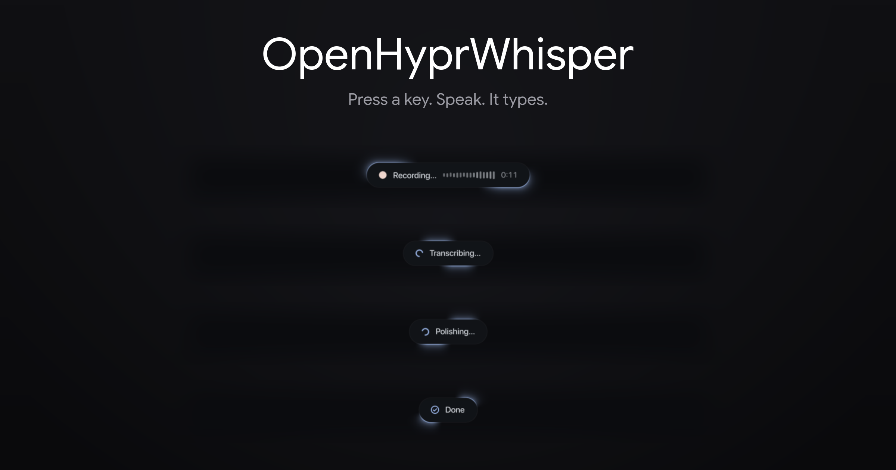

<div align="center">
  
</div>

<div align="center">
  <br/>
  
  
  
  
  
</div>

<br/>

<div align="center">
  <h3>System-wide voice dictation for Hyprland.<br/>Press a key, speak, press again. Your words land in whatever is focused.</h3>
  <p>Browser, terminal, chat window, AI prompt: anything with a text field.
  Fully local and private. Audio never leaves your machine, and with the warm
  daemon a sentence transcribes in <b>about 0.2 seconds</b>.</p>
  <p><sub>Inspired by <a href="https://github.com/Starmel/OpenSuperWhisper">OpenSuperWhisper</a> for macOS, rebuilt natively for the Hyprland/Wayland desktop.</sub></p>
</div>

<br/>

---

## One keypress, four moments

The status pill is a Quickshell overlay that narrates the whole pipeline. It
slides in with Material 3 expressive motion, two accent lights sweeping its
border like the two bulbs of an hourglass, drawn by a custom shader.


**Recording.** A live waveform drawn from the real microphone RMS, and an
elapsed timer. The meter shapes levels on a power curve, the way a dB meter
does, so quiet speech still moves the bars.


**Transcribing.** whisper.cpp runs the utterance on CUDA or Vulkan. A
`whisper-server` daemon keeps the model warm in VRAM, so this takes tenths of
a second instead of reloading ~600 MB per phrase.


**Polishing** (optional). A local LLM cleans up the raw transcript before it
is typed. Adds about 0.2 s with the bundled llama.cpp backend.


**Done.** The text is typed into the focused field with `wtype`, the pill
takes a bow and slides out. If you stopped without saying anything, a silence
gate catches it and nothing is typed: no more hallucinated *"Thank you."*

```
keybind → ohw toggle ──► pw-record (16 kHz wav)      ──► pill: "● Recording…" + waveform
keybind → ohw toggle ──► whisper.cpp (CUDA)          ──► pill: "◌ Transcribing…"
                     ──► replacements + LLM polish   ──► pill: "◌ Polishing…" (optional)
                     ──► wtype into focused window   ──► pill: "✓ Done"
```

---

## What it does

- **Works everywhere.** Browser, terminal, chat apps, IDEs: anything holding
  a focused text input. Like espanso, but for your voice. Injection is
  configurable: type it, paste it, or just put it on the clipboard.
- **Fast.** whisper.cpp with CUDA or Vulkan; with the warm daemon a sentence
  transcribes in ~0.2 s, and the first token of polish lands right behind it.
- **Multilingual.** Language is auto-detected per utterance, so mixed EN/RU/DE/KK
  speech just works, sentence by sentence, with no switching.
- **Private by construction.** No cloud, no telemetry, no subscription. Every
  stage, recording, transcription, and polish, runs on your hardware.
- **Hold-to-talk or toggle.** Bind `ohw start`/`ohw stop` to key press and
  release (or a mouse side button) for walkie-talkie dictation, or `ohw toggle`
  for press-once, speak, press-again.
- **Mic picker and history.** `ohw mic` selects the input device
  interactively; `ohw history` recovers past transcriptions when a text field
  ate your words.
- **A real off switch.** The warm daemons hold ~3 GB of VRAM, so `ohw disable`
  stops them, kills the overlay, and turns the keybind into a no-op. The
  switch persists across reboots; `ohw enable` brings everything back.

## Three correction layers

Raw speech recognition is almost right, which is the annoying kind of right.
Three layers stand between whisper's output and your text field:

1. **Vocabulary prompt.** Bias transcription toward your names and jargon
   before it happens. Free, built into whisper.
2. **Replacements.** Deterministic fixes for stubborn mishearings, one
   `misheard = corrected` rule per line, word-boundary matched, ~10 ms.
3. **LLM polish.** A small local model rewrites the transcript, with two
   modes. **Full** fixes grammar and punctuation for emails and documents.
   **Light** only fixes names and brands, so chat messages still sound like
   you.

The same dictation through both modes:

> raw: `so yeah i was asking cloud code about the elden ring api and it dont work good`
> **light**: `so yeah i was asking Claude Code about the elden ring api and it dont work good`
> **full**: `So yeah, I was asking Claude Code about the Elden Ring API, and it doesn't work well.`

## A pill that dresses for your desktop

<table>
<tr>
<td width="50%"></td>
<td width="50%"></td>
</tr>
</table>

On [end-4/dots-hyprland](https://github.com/end-4/dots-hyprland) the pill
reads your generated Material 3 palette and main font **live**: switch
wallpaper or flip light/dark and it recolors instantly, no restart. Without
end-4 it falls back to a neutral dark look.

It also respects your bar's reserved space, and `OVERLAY_POSITION` moves it:
`bottom` or `top` of the screen, or `window`, where the pill attaches to the
focused window's bottom edge, OpenSuperWhisper style.

There is a **Voice dictation quick toggle** for the end-4 sidebar too, next
to Wi-Fi and Bluetooth: [quickshell/end4](quickshell/end4).

---

## Install

```sh
git clone https://github.com/adilzhanY/OpenHyprWhisper
cd OpenHyprWhisper
./install.sh          # builds whisper.cpp (CUDA/Vulkan auto-detected), downloads the model
```

Requirements: Hyprland (any Wayland compositor works for the core; the
overlay uses `wlr-layer-shell`), `pipewire`, `wtype` (or `ydotool`),
`wl-clipboard`, `curl`, `cmake`, `git`, `python3`. [Quickshell](https://quickshell.org)
is optional, for the pill. An NVIDIA GPU with CUDA, or Vulkan, or a decent
CPU. Arch users can grab `openhyprwhisper-git` from the [AUR](packaging/aur).

Bind it in Hyprland:

```ini
bind = SUPER, Y, exec, ohw toggle
bind = SUPER SHIFT, Y, exec, ohw cancel
```

```lua
-- Hyprland >= 0.55 Lua config: hold middle mouse button to talk
hl.bind("mouse:274", hl.dsp.exec_cmd("ohw start"), { description = "Dictation: hold to record" })
hl.bind("mouse:274", hl.dsp.exec_cmd("ohw stop"), { release = true })
```

> Note: binding the bare middle button consumes normal middle-clicks. If you
> use those, bind a side button instead (`mouse:275` / `mouse:276`) or keep
> the `SUPER+Y` toggle.

And keep the model warm (recommended):

```sh
systemctl --user enable --now openhyprwhisper
```

## Usage

| Command | Action |
|---|---|
| `ohw start` / `ohw stop` | hold-to-talk pair: bind to press and release |
| `ohw toggle` | start recording / stop, transcribe and type |
| `ohw cancel` | discard the current recording (works mid-transcription too) |
| `ohw enable` / `ohw disable` | turn dictation on/off entirely, persistent, frees the VRAM |
| `ohw switch` | flip between the two, bind it to a UI toggle |
| `ohw enabled` | print `on`/`off`; exits 1 when off |
| `ohw daemon start\|stop\|status` | manage the warm-model daemon |
| `ohw mic` | pick a microphone interactively (or `ohw mic <node-name>`) |
| `ohw history [n]` | show the last n transcriptions (default 20) |
| `ohw setup` | download the model, check dependencies |
| `ohw status` | show state, model and daemon info |

## Configuration

**`~/.config/openhyprwhisper/config`** (see [config.example](config.example)):

| Option | Default | Meaning |
|---|---|---|
| `MODEL` | `large-v3-turbo-q5_0` | any ggml model name or absolute path |
| `LANGUAGE` | `auto` | language code, or auto-detect per utterance |
| `INJECT` | `type` | `type` / `paste` / `clipboard` |
| `OVERLAY_POSITION` | `bottom` | `bottom` / `top` (screen edge) or `window` (attach to the focused window) |
| `HISTORY` | `true` | keep transcriptions for `ohw history` |
| `SILENCE_PEAK` | `300` | silence gate threshold, `0` disables |
| `INITIAL_PROMPT` | empty | vocabulary bias: names, jargon, slang |
| `POSTPROCESS` | `false` | LLM polish on/off |
| `POSTPROCESS_MODE` | `full` | `full` fixes everything; `light` only fixes names, keeps your wording |
| `POSTPROCESS_CMD` | bundled script | any stdin to stdout command |

Every option can also be overridden per invocation with an `OHW_*` environment
variable. **`~/.config/openhyprwhisper/replacements`** (see
[replacements.example](replacements.example)) holds the deterministic fixes:
one `misheard = corrected` rule per line, case-insensitive.

## LLM polish backends

**Local (recommended)**: [scripts/polish-local.py](scripts/polish-local.py)
talks to a small LLM (Qwen2.5-3B) served by llama.cpp on your own GPU or CPU.
Warm polish takes **~0.2 s**, fully offline, works in any language:

```sh
cmake -S vendor/llama.cpp -B vendor/llama.cpp/build -DGGML_CUDA=1 -DCMAKE_BUILD_TYPE=Release
cmake --build vendor/llama.cpp/build -j --target llama-server
curl -L -o ~/.local/share/openhyprwhisper/models/Qwen2.5-3B-Instruct-Q4_K_M.gguf \
  https://huggingface.co/bartowski/Qwen2.5-3B-Instruct-GGUF/resolve/main/Qwen2.5-3B-Instruct-Q4_K_M.gguf
systemctl --user enable --now openhyprwhisper-polish
```

**Claude CLI (zero setup)**: [scripts/polish-claude.sh](scripts/polish-claude.sh)
uses the [Claude Code](https://claude.com/claude-code) CLI. No API key or
downloads if you already use Claude, at the cost of ~5-8 s of cloud overhead
per dictation.

Any other stdin to stdout command works too: ollama, an API curl, a sed
script.

## Testing

```sh
tests/run-tests.sh             # everything
tests/run-tests.sh unit        # text/audio processing only (runs anywhere, incl. CI)
tests/run-tests.sh integration # real pipeline: fake mic -> whisper -> clipboard
tests/run-tests.sh ui          # overlay states/positions on a live Hyprland session
```

The suite runs against an isolated config and state (your real setup is
untouched), synthesizes its own audio through a PipeWire null sink, and
skips, never fails, tests whose hardware isn't present.

## License

MIT

---

<div align="center">
  <sub>Built by <a href="https://github.com/adilzhanY">Adilzhan</a> · the pill shots are the real overlay, captured live</sub>
</div>
